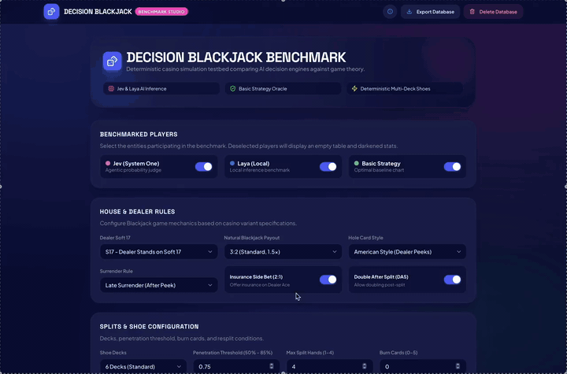

# Decision Blackjack

**Decision Blackjack** is a benchmarking studio and real-time simulator that tests AI decision-making models against the mathematically proven **Optimal Basic Strategy** in casino Blackjack.

It pits three players against each other in synchronized, head-to-head competition under identical conditions:

1. **Optimal Basic Strategy** (Mathematical Oracle + Hi-Lo Card Counter)
2. **Jev** (Remote Cloud AI via TypeSafe System One)
3. **Laya** (Local model running on your host machine)

Watch them play live on a 2x3 casino visualizer with fluid GSAP card animations, or run headless batches of thousands of rounds in seconds to benchmark strategy accuracy, win rates, and bankroll curves.



---

## What Does This Project Do?

In casino blackjack, **Basic Strategy** is a set of mathematically optimal rules derived from probability theory. Playing basic strategy reduces the house edge to under 0.5%—any deviation from it is mathematically suboptimal.

**Decision Blackjack** tests whether AI models understand and adhere to this optimal play:

- **Isolated Identical Tables**: Each participant plays at their own independent table, but they all receive identical card sequences from a shared, deterministic deck.
- **Turn-by-Turn Benchmarking**: Every single decision (Hit, Stand, Double, Split, Surrender) and bet size is evaluated in real time against an optimal game-theoretic oracle.
- **Mistake Categorization**: Tracks where models deviate—Hard Totals, Soft Totals (hands with Aces), Pair Splitting, or Surrendering.
- **Card Counting & Bet Sizing**: Analyzes whether models adjust their wagers to match card counting advantages (Hi-Lo Running Count and True Count).
- **Two Execution Modes**:
  - **Visualizer Mode**: Real-time table view with dealing animations, 90° rotated double downs, neon status badges, and live progress bars.
  - **Fast Batch Mode**: High-speed headless simulation capable of running up to 100,000 rounds for statistically significant benchmarking.

---

## What Do You Need? (Prerequisites)

To run the full suite with both AI players, you need:

### 1. Docker & Docker Compose

- **[Docker Desktop](https://www.docker.com/products/docker-desktop/)** (macOS, Windows, or Linux).
- Docker runs the PostgreSQL database, the FastAPI backend, and the React frontend in containers.

### 2. TypeSafe Jev API Key (Cloud Model)

- **What it is**: Jev is TypeSafe's flagship System One model designed for fast, typed, structured judgments.
- **What you need**: A TypeSafe API key.
- **Where it goes**: Set `TYPESAFE_API_KEY` in your `.env` file.

### 3. Laya Local Model (Host Model)

- **What it is**: Laya is a local deep learning model running natively on your computer outside Docker (e.g. at `http://127.0.0.1:1234`).
- **How it connects**: The Docker container automatically bridges requests to your host machine via `host.docker.internal:1234`.
- **Where it goes**: Set `LAYA_BASE_URL=http://127.0.0.1:1234` in your `.env` file.

> [!TIP]
> **Don't have an API key or local model ready?**  
> You can still run the entire application!
>
> - **Mock Mode**: Turn on "Mock Mode" on the setup screen to run Jev and Laya using built-in simulated providers.
> - **Player Toggles**: Uncheck Jev or Laya to benchmark only the models you want.

---

## How to Run It

### Quickstart (Docker)

1. **Clone the repository**:

   ```bash
   git clone https://github.com/your-username/Decision_Blackjack.git
   cd Decision_Blackjack
   ```

2. **Create your `.env` file**:

   ```bash
   cp .env.example .env
   ```

   Open `.env` and add your `TYPESAFE_API_KEY` (and configure `LAYA_BASE_URL` if running Laya locally).

3. **Start the containers**:

   ```bash
   docker compose up --build
   ```

4. **Open your browser**:
   - **Frontend UI**: [http://localhost:5173](http://localhost:5173)
   - **Backend API Docs (Swagger)**: [http://localhost:8000/docs](http://localhost:8000/docs)
   - **System Health Check**: [http://localhost:8000/health](http://localhost:8000/health)

To stop the containers:

```bash
docker compose down
```

---

### Alternative: Running Locally (Without Docker)

If you are developing locally without Docker containers:

#### 1. Backend (Python 3.12+)

```bash
cd backend
python3 -m venv .venv
source .venv/bin/activate
pip install -e .
uvicorn app.main:app --host 0.0.0.0 --port 8000 --reload
```

#### 2. Frontend (Node.js 18+)

```bash
cd frontend
npm install
npm run dev
```

Open [http://localhost:5173](http://localhost:5173).

---

### Terminal Game (Play Directly)

Want to play a round of Blackjack in your terminal powered by the core engine?

```bash
python3 play.py
```

This launches an interactive game with colored card suits, split hands, insurance prompts, and live bankroll updates.

---

## How Does It Work?

```
┌───────────────────────────────────────────────────────────────┐
│                    React 19 Web Frontend                      │
│        (Vite • Tailwind • shadcn/ui • GSAP Animations)        │
└───────────────▲───────────────────────────────▲───────────────┘
                │ REST API                      │ WebSockets (Live Telemetry)
┌───────────────▼───────────────────────────────▼───────────────┐
│                      FastAPI Backend                          │
│  ┌─────────────────────────────────────────────────────────┐  │
│  │                 Simulation Orchestrator                 │  │
│  │   • Barrier Sync          • Real-Time Deviation Oracle  │  │
│  │   • Generational ShoePool • Non-blocking Flow Control   │  │
│  └──────┬───────────────────────┬───────────────────┬──────┘  │
│         │                       │                   │         │
│         ▼                       ▼                   ▼         │
│  ┌───────────────┐       ┌──────────────┐   ┌──────────────┐  │
│  │ Optimal Table │       │  Jev Table   │   │  Laya Table  │  │
│  │  (Game Math)  │       │ (Cloud API)  │   │  (Host SLM)  │  │
│  └──────┬────────┘       └──────┬───────┘   └──────┬───────┘  │
│         │                       │                  │          │
│         └───────────────────────┼──────────────────┘          │
│                                 ▼                             │
│                  Core Blackjack Engine (Pure FSM)             │
└─────────────────────────────────┬─────────────────────────────┘
                                  ▼
                 PostgreSQL Database (Async Telemetry)
```

### 1. The Three Decision Entities

- **Optimal Basic Strategy**: Uses a mathematical lookup matrix of every possible blackjack situation (hard hands, soft hands, pairs, dealer upcard). It never makes an illegal move and never deviates from mathematically proven strategy.
- **TypeSafe Jev**: Prompts are dynamically generated describing the table situation, legal actions, and hand values. Jev evaluates the scenario and returns a structured action choice via the TypeSafe System One API.
- **Laya**: A local model evaluated using context-aware System One prompts. Communicates via local HTTP inference and receives identical situation options.

### 2. The Generational Shoe Pool (Solving the Desynchronization Problem)

In Blackjack, players make different choices:

- Player A might **Stand** on 12 (taking 0 extra cards).
- Player B might **Hit** on 12, receive a 3, and hit again (taking 2 extra cards).

Because players consume cards at different rates, sharing a single card shoe would cause one player's decision to alter the cards dealt to the next player.

**How Decision Blackjack solves this:**

- Simulations use a **Generational Shoe Pool (`ShoePool`)**.
- Every table starts with an identical, pristine copy of Shoe Generation `#1`.
- When any table reaches cut-card penetration and finishes its round, it requests Generation `#2`.
- Generation `#2` is deterministically generated from `seed = base_seed + (2 * 1000)` and cached in the pool.
- When the other tables eventually exhaust their shoe, they receive the exact same Generation `#2`.
- **Result**: Every model experiences the exact same shoe sequence across the entire simulation, ensuring 100% scientifically valid, reproducible comparisons.

### 3. The Comparison Oracle

Whenever an AI model makes a move, the **Decision Comparison Oracle** independently inspects that player's hand against the dealer's visible card and determines the mathematically optimal action.

- If Jev hits 16 vs dealer 6, the oracle records a **Deviation in Hard Totals** (Optimal was Stand).
- The system computes a running **Optimality Rate** (`optimal_decisions / total_decisions`), live win/loss/push distributions, and True Count bet sizing accuracy.

### 4. Interactive Flow Control & Fault Recovery

- **Speed Slider**: Scale animations seamlessly from `0 ms` (instant card placement for fast testing) up to `2,000 ms` (deliberate, casino-paced dealing).
- **Step Controls**: Step forward one round (`Step Round`) or one individual action (`Step Turn`).
- **Fault Recovery (RNF-02)**: If an external API experiences a network drop, timeout, or rate-limit (HTTP 429), the orchestrator immediately pauses in a safe `PAUSED_ERROR` state. Bankrolls and cards are preserved, and a modal allows you to retry the turn once connectivity is restored.

---

## Environment Variables Reference

All configuration is managed from the single `.env` file at the root:

| Variable                  | Default                                | Purpose                                 |
| :------------------------ | :------------------------------------- | :-------------------------------------- |
| `TYPESAFE_API_KEY`        | _(empty)_                              | API key for TypeSafe Jev remote model   |
| `TYPESAFE_API_URL`        | `https://api.typesafe.ai/v1/systemone` | TypeSafe System One API URL             |
| `TYPESAFE_MODEL`          | `jev-latest`                           | Model alias for Jev                     |
| `LAYA_BASE_URL`           | `http://127.0.0.1:1234`                | URL of your local Laya inference server |
| `LAYA_TIMEOUT_SECONDS`    | `15`                                   | Request timeout for Laya calls          |
| `BACKEND_PORT`            | `8000`                                 | Port for the FastAPI server             |
| `FRONTEND_PORT`           | `5173`                                 | Port for the React web application      |
| `DB_USER` / `DB_PASSWORD` | `postgres` / `postgres`                | PostgreSQL credentials                  |
| `DB_NAME`                 | `decision_blackjack`                   | PostgreSQL database name                |
| `DB_PORT`                 | `5432`                                 | PostgreSQL container port               |

---

## Customizable Rules & Table Options

You can configure standard casino rules directly from the web interface:

- **Soft 17**: Dealer stands on soft 17 (`S17`) or hits on soft 17 (`H17`).
- **Blackjack Payout**: `3:2` (standard), `6:5`, or `1:1`.
- **Dealer Style**: American Peek (checks for blackjack on 10/Ace) or European No Hole Card (ENHC).
- **Double After Split (DAS)**: Enabled or disabled.
- **Surrender**: Late surrender, early surrender, or disabled.
- **Insurance**: Enabled or disabled when dealer shows an Ace.
- **Splits**: Max split hands (1 to 4), Resplit Aces (RSA), and Hit Split Aces.
- **Shoe Configuration**: 1 to 8 standard decks, cut-card penetration (50% to 85%), and burn cards.
- **Betting**: Table minimum and maximum bet limits, starting bankrolls ($10 to $1,000,000).

---

## Project Structure

```text
Decision_Blackjack/
├── docker-compose.yml             # Container configuration (frontend, backend, database)
├── .env.example                   # Environment variables template
├── play.py                        # Interactive CLI blackjack game
├── backend/
│   ├── Dockerfile                 # Backend container definition
│   ├── pyproject.toml             # Python dependencies
│   ├── app/
│   │   ├── env.py                 # Centralized .env loader
│   │   ├── main.py                # FastAPI entry point & CORS
│   │   ├── api/                   # REST endpoints & WebSockets
│   │   ├── engine/                # Core deterministic Blackjack FSM engine
│   │   ├── simulation/            # Multi-agent orchestrator & ShoePool
│   │   ├── models/                # Basic strategy matrices & comparison oracle
│   │   ├── integrations/          # External AI adapters (Jev & Laya)
│   │   └── persistence/           # Database models, telemetry listener & exporters
│   └── tests/                     # Automated pytest test suites (220+ tests)
├── frontend/
│   ├── Dockerfile                 # Frontend container definition
│   ├── package.json               # Frontend dependencies (React 19, Tailwind, GSAP)
│   ├── src/
│   │   ├── components/            # UI components, modals, navbar, control bar
│   │   ├── visualization/         # 2x3 table grid, carpet felts, live stats
│   │   ├── forms/                 # Game rules configuration form
│   │   └── pages/                 # Visualizer, batch, and completion views
│   └── Assets/cards/              # Vector SVG playing cards (52 cards)
└── docs/                          # Architecture guides, rule sheets & session logs
```

---

## Testing & Quality

To run the automated backend test suite (220+ unit and integration tests):

```bash
cd backend
source .venv/bin/activate
pytest tests/
```

To verify frontend TypeScript types and build:

```bash
cd frontend
npx tsc --noEmit
npm run build
```

---

## License

This project is licensed under the [MIT License](LICENSE).
