```mermaid
erDiagram

    RUN ||--|| RUN_CONFIGURATION : "has"
    RUN ||--o{ SIMULATION : "contains"

    SIMULATION ||--o{ PLAYER_SESSION : "has"
    SIMULATION ||--o{ SHOE : "generates"
    SIMULATION ||--o{ ROUND : "contains"

    PLAYER_SESSION ||--o{ PLAYER_SHOE_STATE : "tracks"
    SHOE ||--o{ PLAYER_SHOE_STATE : "used_by"

    ROUND ||--o{ ROUND_PLAYER : "has"
    PLAYER_SESSION ||--o{ ROUND_PLAYER : "participates"

    ROUND ||--o{ CARD_EVENT : "contains"
    SHOE ||--o{ CARD_EVENT : "supplies"

    ROUND_PLAYER ||--o{ HAND : "owns"
    HAND ||--o| HAND : "parent_of"

    HAND ||--o{ CARD_EVENT : "receives"
    HAND ||--o{ DECISION : "has"
    HAND ||--|| HAND_RESULT : "produces"

    ROUND_PLAYER ||--o{ BET : "places"
    HAND ||--o{ BET : "associated_with"

    DECISION ||--o| MODEL_RESPONSE : "produces"

    ROUND_PLAYER ||--o{ BANKROLL_TRANSACTION : "has"
    HAND ||--o{ BANKROLL_TRANSACTION : "related_to"
    BET ||--o{ BANKROLL_TRANSACTION : "causes"


    RUN {
        uuid id PK
        run_status status
        timestamptz created_at
        timestamptz started_at
        timestamptz finished_at
        text error_message
        text data_directory
    }

    RUN_CONFIGURATION {
        uuid id PK
        uuid run_id FK

        soft_17_rule soft_17_rule
        decimal blackjack_payout_ratio
        split_aces_blackjack_rule split_aces_blackjack_rule
        hole_card_rule hole_card_rule

        boolean insurance_enabled
        decimal insurance_payout_ratio

        surrender_rule surrender_rule
        boolean das_enabled
        smallint max_resplit
        boolean rsa_enabled
        boolean hit_split_aces
        charlie_rule charlie_rule

        smallint number_of_decks
        decimal penetration
        smallint burn_cards

        decimal initial_bankroll
        decimal minimum_bet
        decimal maximum_bet

        integer rounds_per_simulation
        boolean rounds_indefinite

        integer simulations_count
        boolean simulations_indefinite

        bigint user_seed

        jsonb optimal_bet_spread
    }


    SIMULATION {
        uuid id PK
        uuid run_id FK

        integer simulation_number
        bigint seed

        simulation_status status
        decimal initial_bankroll
        decimal final_bankroll

        termination_reason termination_reason

        timestamptz started_at
        timestamptz finished_at
    }


    PLAYER_SESSION {
        uuid id PK
        uuid simulation_id FK

        player_type player_type

        decimal initial_bankroll
        decimal current_bankroll

        session_status status
    }


    SHOE {
        uuid id PK
        uuid simulation_id FK

        integer shoe_number
        bigint seed

        jsonb card_order

        smallint total_cards
        smallint burn_cards
        decimal penetration

        uuid generated_by_session_id FK

        timestamptz created_at
    }


    PLAYER_SHOE_STATE {
        uuid id PK

        uuid player_session_id FK
        uuid shoe_id FK

        integer current_position
        integer cards_seen

        integer running_count
        decimal true_count

        timestamptz started_at
        timestamptz finished_at
    }


    ROUND {
        uuid id PK
        uuid simulation_id FK

        integer round_number
        round_status status

        smallint dealer_final_value
        boolean dealer_blackjack
        boolean dealer_bust

        timestamptz started_at
        timestamptz finished_at
    }


    ROUND_PLAYER {
        uuid id PK

        uuid round_id FK
        uuid player_session_id FK

        decimal bankroll_before
        decimal bankroll_after

        player_round_status status

        timestamptz started_at
        timestamptz finished_at
    }


    HAND {
        uuid id PK

        uuid round_player_id FK
        uuid parent_hand_id FK

        smallint hand_number

        boolean is_initial
        boolean is_split

        hand_status status

        smallint final_value
        boolean is_blackjack
        boolean is_bust
    }


    CARD_EVENT {
        uuid id PK

        uuid round_id FK
        uuid hand_id FK
        uuid shoe_id FK

        card_recipient recipient
        card_event_type event_type

        varchar card

        integer sequence_number
        integer shoe_position

        timestamptz created_at
    }


    BET {
        uuid id PK

        uuid round_player_id FK
        uuid hand_id FK

        bet_type bet_type
        decimal amount

        timestamptz created_at
    }


    DECISION {
        uuid id PK

        uuid hand_id FK

        integer decision_number
        decision_type decision_type
        player_action action

        decimal confidence_pct

        integer running_count
        decimal true_count

        decimal bankroll_at_decision

        player_action optimal_reference_action
        boolean agrees_with_optimal

        jsonb state_snapshot

        timestamptz created_at
    }


    MODEL_RESPONSE {
        uuid id PK

        uuid decision_id FK

        model_provider provider
        varchar model_name
        varchar model_version

        jsonb request_payload
        jsonb response_payload

        smallint http_status
        integer latency_ms

        varchar error_type
        text error_message

        timestamptz requested_at
        timestamptz responded_at
    }


    HAND_RESULT {
        uuid id PK

        uuid hand_id FK

        hand_result_type result

        smallint player_value
        smallint dealer_value

        decimal payout_amount
        decimal net_amount

        timestamptz created_at
    }


    BANKROLL_TRANSACTION {
        uuid id PK

        uuid round_player_id FK
        uuid hand_id FK
        uuid bet_id FK

        transaction_type transaction_type

        decimal amount
        decimal balance_before
        decimal balance_after

        timestamptz created_at
    }
```

# 1. Jerarquía principal

La estructura fundamental será:

```
RUN
│
├── CONFIGURATION
│
└── SIMULATION
      │
      ├── PLAYER_SESSION
      │     ├── Jev
      │     ├── Laya
      │     └── Optimal
      │
      ├── SHOE
      │     ├── Shoe 1
      │     ├── Shoe 2
      │     └── ...
      │
      └── ROUND
            ├── Round 1
            ├── Round 2
            └── ...
```


Así queda perfectamente separada una **ejecución**, una **simulación** y una **ronda**.

---

# 2. `RUN`

Representa una ejecución completa.

Ejemplo:

```
Run 8fa...
│
├── 20 simulations
├── 10,000 rounds
├── configuration X
└── status = COMPLETED
```

### Campos importantes

`id` será UUID.

`status`:

```
CREATED
RUNNING
PAUSE_REQUESTED
PAUSED
ERROR
COMPLETED
CANCELLED
```

`data_directory` puede almacenar la ruta asociada:

```
/data/runs/2026-10-06T10-32-15_xxxxx/
```

La API key **no debe aparecer aquí ni en ninguna tabla**.

---

# 3. `RUN_CONFIGURATION`

Esta tabla es el **snapshot inmutable** de la configuración utilizada en ese Run.
Esto es importante porque si cambia S17 a H17, los Runs anteriores deben seguir indicando qué reglas utilizaron.
El documento de [[Reglas de BlackJack]] separa explícitamente las opciones modificables —Soft 17, Blackjack payout, Peek/ENHC, Insurance, Surrender, DAS, Resplit, RSA, número de barajas, penetración, cartas quemadas, bankroll y límites— de las reglas fijas. 

### Configuración de Blackjack

```
soft_17_rule
blackjack_payout_ratio
split_aces_blackjack_rule
hole_card_rule
insurance_enabled
insurance_payout_ratio
surrender_rule
das_enabled
max_resplit
rsa_enabled
hit_split_aces
number_of_decks
penetration
burn_cards
initial_bankroll
minimum_bet
maximum_bet
```

### Configuración experimental

```
rounds_per_simulation
rounds_indefinite

simulations_count
simulations_indefinite

user_seed
```

### Estrategia óptima

```
optimal_bet_spread
```

Aquí utiliza `JSONB` porque el bet spread dependerá de rangos de `true count` y todavía no están fijados exactamente todos los intervalos.

Por ejemplo conceptualmente:

```
true count → unidades
≤ 0        → 1
+1         → 2
+2         → 4
...
≥ +6       → 12
```

---

# 4. `SIMULATION`

Una simulación es una repetición de la configuración.

```
Run
│
├── Simulation 1
├── Simulation 2
├── Simulation 3
└── ...
```

Campos importantes:

```
simulation_number
seed
initial_bankroll
final_bankroll
termination_reason
status
```

La `seed` de la simulación puede derivarse de la seed proporcionada por el usuario.

---

# 5. `PLAYER_SESSION`

Representa a Jev, Laya u Óptima durante **toda una simulación**.

Una simulación tendrá exactamente tres:

```
Simulation 5
│
├── PlayerSession → JEV
├── PlayerSession → LAYA
└── PlayerSession → OPTIMAL
```

Esto permite almacenar el bankroll acumulado.

### `player_type`

```
JEV
LAYA
OPTIMAL
```

### Restricción

Debe existir:

```
UNIQUE(simulation_id, player_type)
```

Así no puede haber dos sesiones de Jev dentro de una misma simulación.

---

# 6. `SHOE`

Un `Shoe` pertenece a una **Simulation**, no a un jugador.

```
Simulation
│
├── Shoe 1
├── Shoe 2
├── Shoe 3
└── ...
```

Un shoe tendrá:

```
shoe_number
seed
card_order
total_cards
burn_cards
penetration
```

### `card_order`

Se puede almacenar como `JSONB`.

Por ejemplo:

```
[
  "7H",
  "AS",
  "10C",
  "4D",
  ...
]
```

Así conservamos el orden exacto producido por el barajado.

---

# 7. `PLAYER_SHOE_STATE`

Esta entidad resuelve el problema de que tres jugadores utilizan el mismo shoe, pero lo consumen de manera diferente.

Ejemplo:

```
Shoe 2
│
├── Jev
│    └── position = 182
│
├── Laya
│    └── position = 165
│
└── Optimal
     └── position = 190
```

### Campos

```
current_position
cards_seen
running_count
true_count
```

Esto significa que **no duplicamos el shoe**.

Duplicamos únicamente el estado de consumo.

### Restricción

```
UNIQUE(player_session_id, shoe_id)
```

Un jugador solamente tendrá un estado para un determinado shoe.

---

# 8. Generación del siguiente shoe


```
Jev necesita Shoe 2
        ↓
¿Existe Shoe 2?
        ↓
      No
        ↓
Orchestrator genera Shoe 2
        ↓
Guardar Shoe 2
        ↓
Jev empieza a utilizarlo
```

Después:

```
Laya necesita Shoe 2
        ↓
¿Existe?
        ↓
       Sí
        ↓
Usar Shoe 2
```

No se vuelve a barajar.

El campo:

```
generated_by_session_id
```

es opcional y únicamente sirve como auditoría para saber qué jugador fue el primero en provocar su creación.

---

# 9. `ROUND`

Una `Round` representa la unidad experimental común.

```
Simulation 3
│
├── Round 1
├── Round 2
└── Round 3
```

La ronda es compartida conceptualmente por:

```
Jev
Laya
Optimal
```

pero sus estados permanecen aislados.

### Campos

```
round_number
status
dealer_final_value
dealer_blackjack
dealer_bust
```

El documento de reglas determina que el dealer tiene un comportamiento determinista y que las condiciones de victoria, derrota y Push dependen de la comparación de valores. 

### Restricción

```
UNIQUE(simulation_id, round_number)
```

---

# 10. `ROUND_PLAYER`

Esta es la relación entre:

```
ROUND
```

y:

```
PLAYER_SESSION
```

Por ejemplo:

```
Round 183
│
├── RoundPlayer → Jev
├── RoundPlayer → Laya
└── RoundPlayer → Optimal
```

Aquí almacenamos el estado financiero de ese jugador **para esa ronda**.

```
bankroll_before
bankroll_after
status
```

Esto nos permite reconstruir fácilmente una gráfica de bankroll.

### Restricción

```
UNIQUE(round_id, player_session_id)
```

---

# 11. `HAND`

Esta tabla resuelve completamente el problema de Split.

Una ronda normal:

```
Jev
└── Hand 1
```

Con split:

```
Jev
├── Hand 1
└── Hand 2
```

Con resplit:

```
Jev
├── Hand 1
├── Hand 2
├── Hand 3
└── Hand 4
```

La relación:

```
parent_hand_id
```

permite representar el árbol de manos.

Por ejemplo:

```
Hand 1
│
└── split
     ├── Hand 2
     └── Hand 3
```

---

# 12. `CARD_EVENT`

Esta tabla registra **cada aparición de una carta**.

No solamente:

```
Player cards = A♠ 10♥
```

sino el historial:

```
1 → Player → A♠
2 → Dealer → 7♦
3 → Player → 10♥
4 → Dealer → K♣
5 → Player → 3♠
```

Esto es importante porque tu requisito solicita registrar las cartas durante toda la ronda. 

### Campos importantes

`sequence_number`:

Permite reconstruir el orden temporal.

`shoe_position`:

Permite saber qué carta concreta de qué shoe fue utilizada.

`shoe_id`:

Permite saber de cuál shoe salió.

`hand_id`:

Indica a qué mano pertenece si es una carta de jugador.

Para el dealer:

```
hand_id = NULL
recipient = DEALER
```

---

# 13. `BET`

Las apuestas se separan de las decisiones.

Esto es importante porque:

```
Bet = cantidad monetaria
Decision = acción tomada
```

Una ronda puede tener:

```
Initial bet → $50
Double      → $50
Split       → $50
Insurance   → $25
```

Por eso `bet_type` podría ser:

```
INITIAL
DOUBLE
SPLIT
INSURANCE
```

La apuesta inicial pertenece a `RoundPlayer`; las apuestas adicionales pueden asociarse a una `Hand`.

---

# 14. `DECISION`

Esta tabla guarda **cada decisión individual**.

Por ejemplo:

```
Hand 1
│
├── Decision 1 → HIT
├── Decision 2 → HIT
└── Decision 3 → STAND
```

Esto satisface directamente el requerimiento de registrar las decisiones individuales. 

### Campos importantes

```
decision_number
action
confidence_pct
running_count
true_count
bankroll_at_decision
state_snapshot
optimal_reference_action
```

---

# 15. `optimal_reference_action`

Este campo es especialmente importante.

No debemos hacer:

```
Decision Jev #3
       ↕
Decision Optimal #3
```

porque no necesariamente están jugando el mismo estado.

Ejemplo:

```
Estado:
Player = 16
Dealer = 10
True Count = +3

Jev → HIT
Optimal reference → STAND
```

Jev puede recibir una carta y ahora estar en:

```
Player = 19
```

mientras que Óptima, que se plantó, sigue en:

```
Player = 16
```

Por tanto, para medir correctamente:

**Agreement with Optimal Strategy**

debemos guardar en la propia decisión de Jev:

```
optimal_reference_action = STAND
```

La misma lógica aplica a Laya.

Esto convierte la comparación en:

```
Estado exacto de Jev
       ↓
Jev decision
       │
       └── Optimal reference para ese mismo estado
```

y no en una comparación artificial de turnos.

---

# 16. `state_snapshot`

También recomiendo conservar un pequeño snapshot del estado que evaluó el modelo.

Conceptualmente:

```
{
  "player_cards": ["10H", "6S"],
  "dealer_upcard": "7D",
  "running_count": 3,
  "true_count": 1.5,
  "bankroll": 1250.00
}
```

Esto será muy útil para auditoría.

Los datos redundantes aquí son **intencionales**: no es la fuente primaria del estado de juego, sino la fotografía exacta del estado utilizado para tomar una decisión.

---

# 17. `MODEL_RESPONSE`

Esta tabla conserva la respuesta completa de Jev/Laya.

El requisito explícitamente indica que debe conservarse la respuesta completa de los modelos. 

Separaremos:

```
Decision
```

de:

```
ModelResponse
```

De esta manera:

```
Decision
├── action = HIT
├── confidence = 87%
└── ...

ModelResponse
├── request_payload
├── response_payload
├── model_name
├── model_version
└── latency
```

Así podemos consultar fácilmente decisiones sin tener que procesar JSON.

Y si posteriormente quieres analizar exactamente qué recibió y devolvió el modelo, tienes la información original.

---

# 18. `HAND_RESULT`

Cada mano tendrá exactamente un resultado.

Por ejemplo:

```
Hand 1 → WIN
Hand 2 → LOSS
```

### Resultados posibles

```
WIN
LOSS
PUSH
BLACKJACK
BUST
SURRENDER
```

Según las reglas, el Blackjack natural tiene una jerarquía especial respecto a un 21 formado por más cartas. 

### Campos

```
player_value
dealer_value
payout_amount
net_amount
```

---

# 19. `BANKROLL_TRANSACTION`

Esta tabla permite reconstruir financieramente una ronda.

Ejemplo:

```
Bankroll $1,000
      ↓
Bet -$50
      ↓
Loss
      ↓
Bankroll $950
```

El campo `amount` tendrá una convención sencilla:

```
positivo → entra dinero
negativo → sale dinero
```

Así:

```
balance_after = balance_before + amount
```

Puede registrar:

```
BET
PAYOUT
REFUND
INSURANCE
SURRENDER
ADJUSTMENT
```

Esto permite posteriormente analizar el bankroll sin depender únicamente de los resultados de las manos.

---

# 20. El dealer

No se hace una tabla `DEALER`.

El dealer es parte del estado de la `ROUND`, mientras que sus cartas están en `CARD_EVENT`.

La estructura queda:

```
ROUND
│
├── Dealer
│    └── CardEvents
│
└── RoundPlayers
     ├── Jev
     ├── Laya
     └── Optimal
```

Tiene sentido porque las reglas definen al dealer como una entidad determinista, sin decisiones estratégicas. 

---

# 21. Relaciones principales

La cardinalidad final queda:

```
RUN 
  1 ─── 1 CONFIGURATION

RUN
  1 ─── N SIMULATIONS

SIMULATION
  1 ─── 3 PLAYER_SESSIONS

SIMULATION
  1 ─── N SHOES

SIMULATION
  1 ─── N ROUNDS

PLAYER_SESSION
  1 ─── N PLAYER_SHOE_STATES

SHOE
  1 ─── N PLAYER_SHOE_STATES

ROUND
  1 ─── 3 ROUND_PLAYERS

ROUND_PLAYER
  1 ─── N HANDS

HAND
  1 ─── N DECISIONS

HAND
  1 ─── N CARD_EVENTS

HAND
  1 ─── 1 HAND_RESULT

ROUND_PLAYER
  1 ─── N BETS

ROUND_PLAYER
  1 ─── N BANKROLL_TRANSACTIONS

DECISION
  1 ─── 0..1 MODEL_RESPONSE
```

---

# 22. Restricciones de integridad importantes

Además de las FK, imponer estas restricciones:

### Run

```
id → UUID
```

### Simulation

```
UNIQUE(run_id, simulation_number)
simulation_number > 0
```

### PlayerSession

```
UNIQUE(simulation_id, player_type)
```

### Shoe

```
UNIQUE(simulation_id, shoe_number)
```

### PlayerShoeState

```
UNIQUE(player_session_id, shoe_id)
current_position >= 0
running_count = INTEGER
```

### Round

```
UNIQUE(simulation_id, round_number)
round_number > 0
```

### RoundPlayer

```
UNIQUE(round_id, player_session_id)
```

### Decision

```
decision_number > 0
confidence_pct BETWEEN 0 AND 100
```

### Money

```
amount >= 0
```

para `Bet`, mientras que `BankrollTransaction.amount` puede ser positivo o negativo.

---

# 23. Índices

Los índices que considero esenciales son:

```
SIMULATION(run_id)

PLAYER_SESSION(simulation_id, player_type)

SHOE(simulation_id, shoe_number)

PLAYER_SHOE_STATE(player_session_id, shoe_id)

ROUND(simulation_id, round_number)

ROUND_PLAYER(round_id, player_session_id)

HAND(round_player_id)

CARD_EVENT(round_id, sequence_number)

CARD_EVENT(shoe_id, shoe_position)

DECISION(hand_id, decision_number)

MODEL_RESPONSE(decision_id)

BET(round_player_id)

BANKROLL_TRANSACTION(round_player_id, created_at)
```

Especialmente importante será:

```
CARD_EVENT(round_id, sequence_number)
```

porque permite reconstruir la secuencia de una ronda.

---

# 24. Datos derivados

No crear columnas o tablas permanentes para:

```
Win Rate
Loss Rate
Push Rate
Profit/Loss acumulado
ROI
Agreement %
```

Pueden calcularse a partir de:

```
HAND_RESULT
BANKROLL_TRANSACTION
DECISION
ROUND_PLAYER
```

Por ejemplo:

```
Agreement %
=
decisiones donde action = optimal_reference_action
/
decisiones comparables
```

Esto evita almacenar información que podría quedar desactualizada.

---

# 25. Qué podemos reconstruir con este modelo

Una única ronda podría reconstruirse completamente:

```
Round 824
│
├── Configuration
│
├── Dealer
│    ├── 7♦
│    ├── K♣
│    └── 4♥
│
├── Jev
│    ├── Bet $50
│    ├── Hand 1
│    │    ├── A♠
│    │    ├── 6♥
│    │    ├── HIT
│    │    ├── 3♣
│    │    └── STAND
│    ├── Model responses
│    └── Result
│
├── Laya
│    └── ...
│
└── Optimal
     └── ...
```

Y además podremos saber:

```
¿De qué shoe salió cada carta?
¿En qué posición estaba?
¿Cuál era el running count?
¿Cuál era el true count?
¿Cuánto bankroll tenía el jugador?
¿Qué decidió?
¿Qué habría hecho Optimal en exactamente ese estado?
¿Qué respondió Jev/Laya?
¿Cuánto tardó?
¿Cuánto dinero ganó o perdió?
```

Eso hace que la BD sea adecuada no solo para **guardar partidas**, sino para el objetivo real del proyecto: **analizar el comportamiento de los modelos**.

---

# 26. Decisión arquitectónica importante: la BD no controla el juego

La base de datos será un **registro persistente**, no el motor de Blackjack.

El flujo correcto será:

```
Blackjack Engine
      ↓
Simulation Orchestrator
      ↓
estado / eventos
      ├──────────────→ PostgreSQL
      │
      └──────────────→ Frontend
```

No queremos que el motor tenga que consultar PostgreSQL para decidir si una mano tiene 17.

La BD almacena lo ocurrido; el motor determina qué puede ocurrir.

---

# 27. Modelo final por dominios

Para verlo de forma más limpia, las 15 entidades se agrupan así:

### Ejecución

```
RUN
RUN_CONFIGURATION
SIMULATION
```

### Participantes

```
PLAYER_SESSION
```

### Shoes

```
SHOE
PLAYER_SHOE_STATE
```

### Juego

```
ROUND
ROUND_PLAYER
HAND
CARD_EVENT
```

### Decisiones / IA

```
DECISION
MODEL_RESPONSE
```

### Economía

```
BET
HAND_RESULT
BANKROLL_TRANSACTION
```

Esta separación es bastante buena para el proyecto porque refleja directamente sus responsabilidades.

---

## Observación Importante
El shoe actual se utiliza durante la ronda completa; la penetración se evalúa al finalizar la ronda y el siguiente shoe queda disponible para la siguiente ronda de esa mesa.
