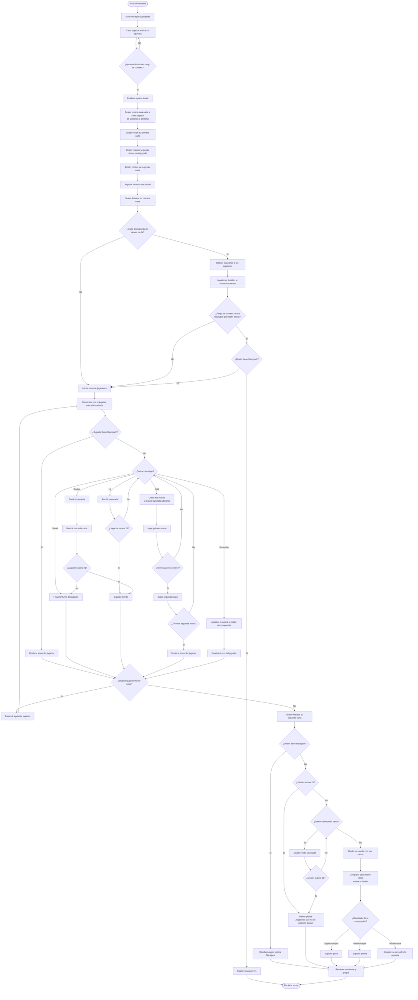

Dentro de blackjack existen diferentes reglas que cambian la forma en la que se juega el blackjack. Las reglas que cambian se muestran en [[Reglas de BlackJack]].
Aún así, el flujo de una ronda de blackjack suele suceder de una forma similar 
independientemente de las reglas cambiantes.

---
# Etapas de una Ronda

1. **Apuesta inicial**: La mesa se abre para que los jugadores puedan hacer su apuesta. La apuesta que los jugadores pueden hacer es individual y debe estar dentro del rango que establece la mesa (Ejemplo: un jugador apuesta $100 en una mesa con un rango de $50 - $1000). 
2. **Repartición de cartas**: Después de hacer las apuestas, la mesa se cierra y el dealer comienza a repartir las cartas. Para repartir las cartas, el dealer va de su izquierda a derecha entregando una carta a la vez por jugador y para él. Por ejemplo, en una mesa con un solo jugador, el dealer le da una carta al jugador, se da una carta a si mismo, le da otra carta al jugador y finalmente se da su segunda carta el dealer. Es importante mencionar que las cartas del jugador se entregan de forma que se vea lo que tiene y que inicialmente, las cartas del dealer se encuentran tapadas, pero una vez que se entregan todas las cartas entonces el dealer destapa la primera carta que se entregó a si mismo.
3. **Juego**: Durante esta etapa los jugadores pueden tomar decisiones según las cartas que tengan y para superar el valor de las cartas del dealer sin pasarse de 21. Con el mismo orden que se repartieron las cartas es que los jugadores irán tomando sus decisiones, empezando por el que esté más a la izquierda del dealer y terminando con el que esté a la derecha. También es importante decir que el hecho de que un jugador se pase o pierda no hace que los demás jugadores pierdan instantáneamente. Las decisiones que cada jugador puede hacer son:
	1. **Hit**: El jugador pide una carta. Esta acción se puede hacer las veces que sean mientras no se pase de 21.
	2. **Stand**: El jugador se queda con las cartas que tiene. Esta acción se puede hacer una sola vez e indica el fin de turno del jugador. Se puede hacer desde un inicio, sin tener que pedir cartas.
	3. **Double**: Al recibir sus dos cartas iniciales, el jugador puede doblar su apuesta y recibir una sola carta más. Esta última carta que se le entrega se suele poner de forma horizontal. Si un jugador hace double se le entrega una última carta y termina su turno.
	4. **Split**: Cuando un jugador recibe dos cartas iguales (ejemplo: dos 8 de corazones) puede o no hacer split. Esto consiste en dividir su mano en dos nuevas manos independientes, apostando otra vez la cantidad que apostó originalmente (si apostó $50 e hizo split, entonces debe apostar otros $50). Al hacer split, el jugador empieza a jugar una de las dos manos y luego la otra. En cada mano puede hacer las mismas acciones que como si no hubiera hecho split a menos de que las reglas digan lo contrario. Si el jugador pierde una de las dos manos, la otra mano continua y en caso de ganar se le paga lo correspondiente a cada mano.
	5. **Surrender**: Al recibir sus cartas, el jugador puede rendirse y recuperar la mitad de su apuesta. Existen reglas variables que permiten hacer esto después de pedir cartas (late surrender) o que no permiten rendirse.
	6. **Insurance**: Cuando la carta descubierta del dealer es un As, entonces los jugadores tienen la oportunidad de hacer una apuesta secundaria por la mitad de su apuesta. En caso de que el dealer tenga blackjack, los jugadores que aseguraron ganan esa apuesta secundaria y se paga 2:1. En algunos casos, en cuanto se cierran los seguros el dealer revisa si tiene blackjack y si sí lo tiene termina la ronda y paga los seguros. En otros casos el juego continua y al finalizar la ronda el dealer revisa si tiene blackjack, y en caso de que sí entonces paga los seguros. Si el dealer no tiene blackjack entonces los jugadores pierden los seguros.
4. **Pagos**: Una vez que todos los jugadores pasaron, el dealer destapa su segunda carta y pide o se queda quieto de acuerdo a las reglas. Existen distintos casos que provocan que el dealer pague o no a los jugadores.
	1. Un jugador gana cuando hace blackjack, supera al dealer en su cuenta de cartas obtenidas o si el dealer se pasa de 21.
	2. Un jugador pierde cuando se pasa de 21 o cuando el dealer obtiene una cuenta mayor que él.
	3. Los jugadores empatan con el dealer si obtienen el mismo valor, en este caso no pierden su apuesta pero tampoco ganan nada. Un blackjack vs blackjack es empate.
---
# Diagrama de una Ronda

