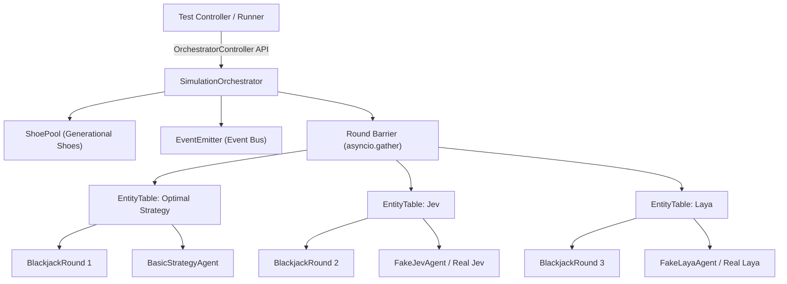

# Simulation Orchestrator Documentation

**Package**: `backend/app/simulation/`  
**Specification**: `specs/002-simulation-orchestrator/`  
**Date**: 2026-10-10

---

## 1. Overview & Architecture

The **Simulation Orchestrator** is an in-memory, headless multi-agent benchmarking coordinator for Blackjack. It enables head-to-head performance comparisons across distinct decision entities (Jev, Laya, and Optimal Strategy) under identical, reproducible initial conditions without depending on external network APIs, databases, or graphical user interfaces.



### Core Components

1. **`SimulationOrchestrator` (`backend/app/simulation/orchestrator.py`)**:
   - Manages lifecycle state (`INITIALIZING`, `RUNNING`, `PAUSED`, `PAUSED_ERROR`, `STOPPED`, `COMPLETED`).
   - Synchronizes concurrent table progression using an `asyncio` round barrier (`FR-004`, `FR-005`).
   - Provides programmatic flow control: `start()`, `pause()`, `resume()`, `step_round()`, `step_turn()`, `stop()`, and `retry_failed_entity()`.
   - Enforces composite stopping criteria (`max_rounds`, all-bankrupt, or manual stop).

2. **`EntityTable` (`backend/app/simulation/table.py`)**:
   - Isolates an individual table running a `BlackjackRound` instance for one attached `DecisionProvider`.
   - Converts table and hand state into immutable `DecisionContext` snapshots.
   - Validates agent decisions against engine legal actions (`FR-010`).
   - Tracks individual bankrolls, win/loss/push/blackjack counters, and bankruptcy elimination.

3. **`ShoePool` (`backend/app/simulation/shoe_pool.py`)**:
   - Generational shoe repository managing deterministic shoe sequences across desynchronized tables (`FR-011`).
   - Seeds generations via `seed = base_seed + (generation * 1000)`.
   - When any table crosses its cut card, it checks the pool: if that generation exists, it adopts it; if not, it deterministically generates, caches, and adopts it.
   - Every table receives an independent pristine clone of the generation shoe to prevent cross-table deck contamination.

4. **`EventEmitter` (`backend/app/simulation/events.py`)**:
   - Decoupled in-memory asynchronous pub/sub bus broadcasting domain events (`ROUND_STARTED`, `DECISION_APPLIED`, `ROUND_SETTLED`, `SHOE_RESHUFFLED`, etc.) for persistence and visualization.

---

## 2. Decision Provider Interface & Fake Agents

All agents implement the `DecisionProvider` protocol defined in `backend/app/simulation/interfaces.py`:

```python
from typing import Protocol, runtime_checkable
from app.simulation.types import AgentDecision, DecisionContext, EntityType

@runtime_checkable
class DecisionProvider(Protocol):
    """Abstract interface for all blackjack decision agents."""

    @property
    def name(self) -> str:
        """Human-readable identifier of the agent."""
        ...

    @property
    def entity_type(self) -> EntityType:
        """Category of the decision entity (OPTIMAL, JEV, LAYA)."""
        ...

    async def get_decision(self, context: DecisionContext) -> AgentDecision:
        """Produce an action decision given the observable table state."""
        ...
```

### Swapping Fake Agents with Real Providers

Temporary test agents live in `backend/app/simulation/agents/fake_agents.py` (`FakeJevAgent`, `FakeLayaAgent`). To replace them with real model integrations in future specifications:

1. Create real agent implementation conforming to `DecisionProvider`:
   - `backend/app/simulation/agents/jev_agent.py` (e.g., calling TypeSafe System One client).
   - `backend/app/simulation/agents/laya_agent.py` (e.g., running local PyTorch / ONNX model weights).
2. Ensure `get_decision(context)` returns an `AgentDecision`:
   ```python
   AgentDecision(
       action=Action.HIT, # Action.STAND, Action.DOUBLE, Action.SPLIT, etc.
       confidence=0.92,
       latency_ms=14.5,
       reasoning="Policy logit argmax",
       metadata={"tokens": 128, "version": "v1.0"}
   )
   ```
3. Register the real agent with the orchestrator:
   ```python
   orchestrator.add_entity("jev", RealJevAgent(api_key=...))
   orchestrator.add_entity("laya", RealLayaAgent(model_path=...))
   ```
4. **No modifications to `SimulationOrchestrator`, `EntityTable`, or the core engine are required!**

---

## 3. Quickstart Example

```python
import asyncio
from app.engine.rules import TableRules
from app.simulation import (
    BasicStrategyAgent,
    FakeJevAgent,
    FakeLayaAgent,
    SessionStatus,
    SimulationConfig,
    SimulationOrchestrator,
)

async def main():
    config = SimulationConfig(
        session_id="benchmark-001",
        seed=42,
        max_rounds=50,
        initial_bankroll=1000.0,
        table_rules=TableRules(min_bet=10.0, max_bet=500.0),
    )

    orchestrator = SimulationOrchestrator(config)
    orchestrator.add_entity(BasicStrategyAgent())
    orchestrator.add_entity(FakeJevAgent(simulated_latency_ms=1.0))
    orchestrator.add_entity(FakeLayaAgent(simulated_latency_ms=0.5))

    await orchestrator.start()
    assert orchestrator.status == SessionStatus.COMPLETED

    print("\n--- Benchmark Final Metrics ---")
    for eid, metrics in orchestrator.session.metrics.items():
        print(f"[{eid.upper()}] Bankroll: ${metrics.current_bankroll:.2f} | Net: ${metrics.net_profit:+.2f} | Wins: {metrics.wins}/{metrics.rounds_played}")

if __name__ == "__main__":
    asyncio.run(main())
```

---

## 4. Test Suite Execution

Run all 41 simulation unit and integration tests:

```bash
PYTHONPATH=backend python3 -c "
import importlib
test_mods = [
    'test_simulation_events', 'test_simulation_agents', 'test_simulation_shoe_pool',
    'test_simulation_table', 'test_simulation_orchestrator', 'test_simulation_flow_control',
    'test_simulation_faults', 'test_simulation_shoe_lifecycle', 'test_simulation_telemetry',
    'test_simulation_quickstart'
]
for m in test_mods:
    mod = importlib.import_module(f'tests.{m}')
    for attr in dir(mod):
        if attr.startswith('test_'):
            getattr(mod, attr)(); print(f'✓ {m}.{attr}')
"
```
