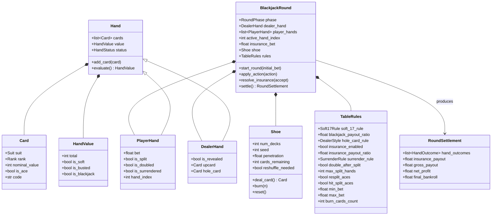
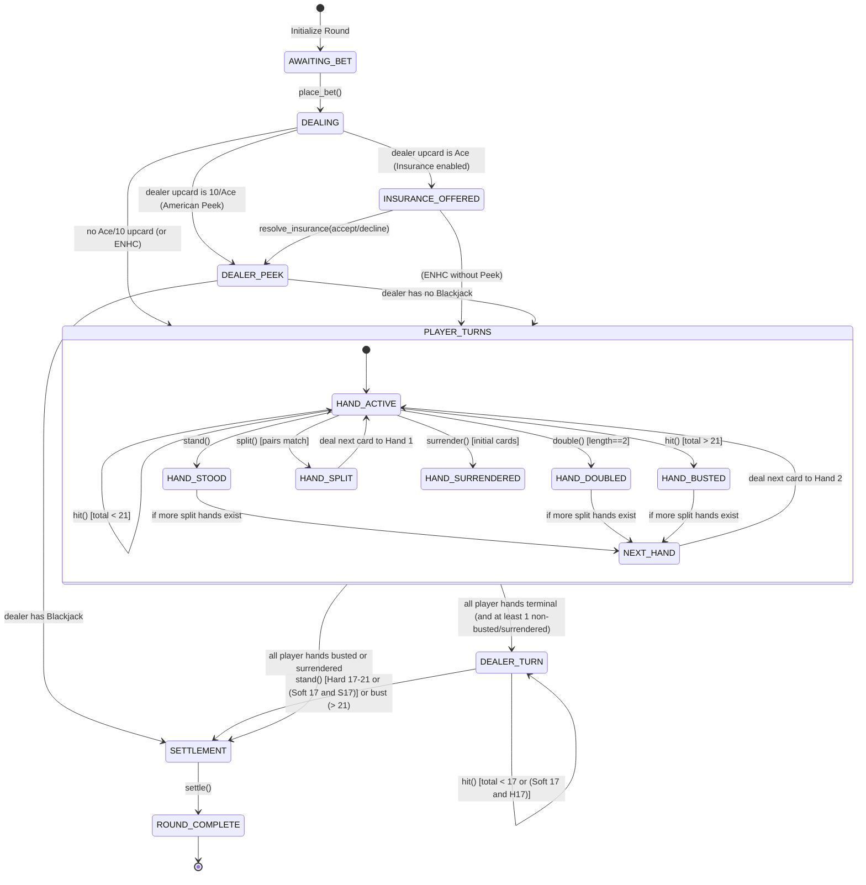

# Data Model: Core Blackjack Engine

**Feature**: [spec.md](spec.md)  
**Package**: `backend/app/engine/`  
**Date**: 2026-10-09

## 1. Class & Entity Diagrams

---

## 2. Entities & Field Definitions

### 2.1. `Card`
Immutable value object representing a standard playing card.
- `suit: Suit`: Enum (`HEARTS`, `DIAMONDS`, `CLUBS`, `SPADES`).
- `rank: Rank`: Enum (`TWO` through `TEN`, `JACK`, `QUEEN`, `KING`, `ACE`).
- `nominal_value: int`: 2–9 for numeric ranks, 10 for 10/J/Q/K, 11 for Ace.
- `is_ace: bool`: True if rank == Rank.ACE.

### 2.2. `HandValue`
Immutable evaluation result of a hand's cards:
- `total: int`: Highest valid score <= 21, or lowest busting score > 21.
- `is_soft: bool`: True if an Ace is currently counted as 11 points without busting.
- `is_busted: bool`: True if total > 21.
- `is_blackjack: bool`: True if exactly 2 cards equal 21 on a non-split hand.

### 2.3. `PlayerHand`
Represents an individual active or resolved player hand on the table:
- `cards: list[Card]`: Cards held by this hand.
- `bet: float`: Current amount staked on this specific hand (doubles if player doubles down).
- `status: HandStatus`: `ACTIVE`, `STOOD`, `BUSTED`, `DOUBLED`, `SURRENDERED`, `NATURAL_BLACKJACK`, `SPLIT`.
- `is_split: bool`: True if this hand was spawned from a split action.
- `is_doubled: bool`: True if Double Down was applied.
- `is_surrendered: bool`: True if surrender was applied.
- `hand_index: int`: Zero-based index within the player's split hands (0 to max_split_hands-1).

### 2.4. `DealerHand`
Represents the dealer's hand:
- `cards: list[Card]`: Cards held by the dealer.
- `is_revealed: bool`: False during initial player turns (hole card hidden); True during dealer turn.
- `upcard: Card | None`: First face-up card visible to players.
- `hole_card: Card | None`: Face-down card (in American Peek mode).

### 2.5. `Shoe`
Stateful multi-deck card container:
- `num_decks: int`: 1 to 8.
- `seed: int | None`: PRNG seed for deterministic shuffle.
- `penetration: float`: Cut-card fraction (e.g. 0.75).
- `burn_cards_count: int`: Number of cards to discard on new shoe creation.
- `card_sequence: list[Card] | None`: Optional pre-arranged FIFO cards for test controllers.
- `cards: list[Card]`: Remaining cards in the shoe.
- `cut_card_index: int`: Index threshold at which `reshuffle_needed` is flagged.
- `reshuffle_needed: bool`: Set to True when cut card threshold is crossed.

### 2.6. `TableRules`
Configuration parameters governing game mechanics:
- `soft_17_rule: Soft17Rule`: `STAND_ON_SOFT_17` (`S17`) or `HIT_SOFT_17` (`H17`).
- `blackjack_payout_ratio: float`: 1.5 (3:2), 1.2 (6:5), or 1.0 (1:1).
- `hole_card_rule: DealerStyle`: `AMERICAN_PEEK` or `EUROPEAN_NO_HOLE_CARD` (`ENHC`).
- `insurance_enabled: bool`: True to allow insurance against Ace upcards.
- `insurance_payout_ratio: float`: 2.0 (2:1 payout).
- `surrender_rule: SurrenderRule`: `NONE`, `LATE`, or `EARLY`.
- `double_after_split: bool`: True if doubling is permitted after splitting (`DAS`).
- `max_split_hands: int`: Maximum number of hands a player may hold via splits (typically 4).
- `resplit_aces: bool`: True if Aces can be re-split (`RSA`).
- `hit_split_aces: bool`: False if split Aces receive exactly one card and stand.
- `min_bet: float`: Minimum allowable initial bet.
- `max_bet: float`: Maximum allowable initial bet.

### 2.7. `RoundSettlement`
Comprehensive financial and outcome summary for a concluded round:
- `hand_outcomes: list[HandSettlement]`: Per-hand outcome (`result: SettlementResult`, `hand_total: int`, `dealer_total: int`, `bet: float`, `payout: float`, `net_profit: float`).
- `insurance_bet: float`: Staked insurance wager (0.0 if not taken).
- `insurance_payout: float`: Payout from insurance (0.0 if lost, 3x staked if won).
- `total_staked: float`: Sum of initial bet, doubles, splits, and insurance.
- `gross_return: float`: Total money returned (payouts + returned stakes).
- `net_pnl: float`: Gross return minus total staked.
- `final_bankroll: float`: Player bankroll after applying net settlements.

---

## 3. Finite State Machine Transitions

