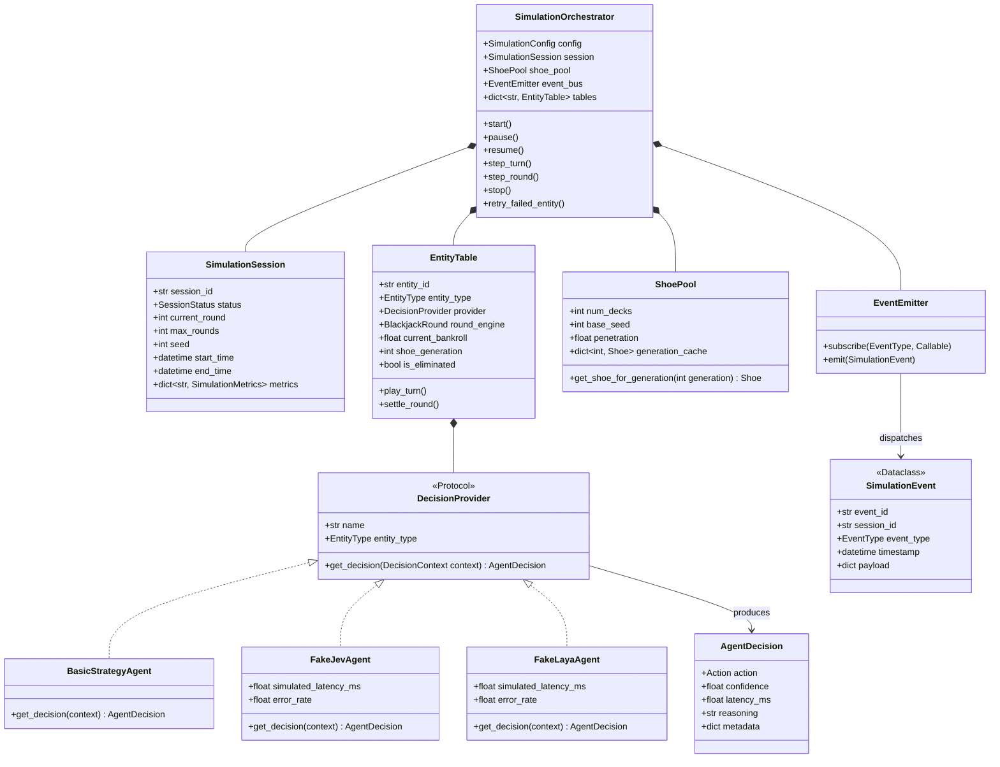
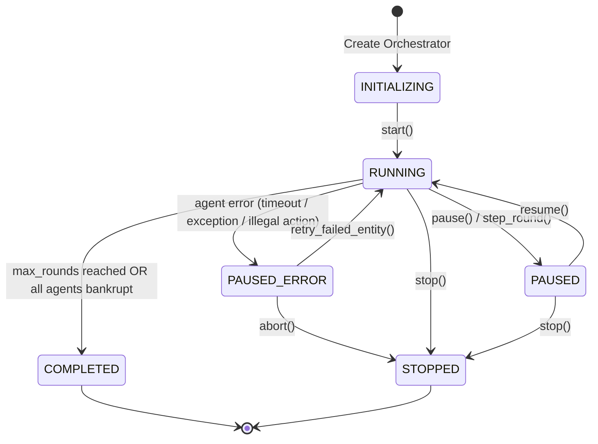

# Data Model: Simulation Orchestrator

**Feature**: [spec.md](spec.md)  
**Package**: `backend/app/simulation/`  
**Date**: 2026-10-10

---

## 1. Class & Entity Diagrams

---

## 2. State Machine Transitions

---

## 3. Entity Definitions & Field Specifications

### 3.1. `SimulationConfig`
Configuration model defining parameters for the simulation experiment:
- `session_id: str`: Unique UUID identifier for the run.
- `seed: int`: Root PRNG seed for deterministic shoe and provider generation.
- `max_rounds: int`: Maximum number of rounds to execute (default: 100).
- `initial_bankroll: float`: Starting capital per table (default: 1000.0).
- `table_rules: TableRules`: Casino game rules configuration (S17, 3:2, Peek/ENHC, etc.).
- `stop_on_all_bankrupt: bool`: Terminate session early if all entities are eliminated (default: True).

### 3.2. `SessionStatus` (Enum)
Lifecycle status of the simulation:
- `INITIALIZING`: Tables and shoe pool configured; awaiting start command.
- `RUNNING`: Actively executing rounds across tables.
- `PAUSED`: Execution suspended cleanly between turns or rounds; state preserved.
- `PAUSED_ERROR`: Suspended due to an agent error; awaiting retry or abort.
- `STOPPED`: Manually cancelled or aborted before completion.
- `COMPLETED`: Naturally completed all rounds or met stopping criteria.

### 3.3. `EntityType` (Enum)
- `OPTIMAL`: Mathematical game theory / Basic Strategy + card counting.
- `JEV`: Remote System One AI entity.
- `LAYA`: Local deep learning model entity.

### 3.4. `DecisionContext`
Immutable state snapshot passed to a `DecisionProvider` to request an action:
- `session_id: str`: Active simulation session.
- `round_number: int`: Current round number.
- `hand_index: int`: Active split hand index.
- `player_cards: list[Card]`: Cards held in the active player hand.
- `player_total: int`: Current point total.
- `is_soft: bool`: True if hand holds an Ace counted as 11.
- `dealer_upcard: Card`: Visible dealer card.
- `legal_actions: list[Action]`: Actions permitted by the engine (`HIT`, `STAND`, `DOUBLE`, `SPLIT`, `SURRENDER`).
- `can_insure: bool`: True if insurance is currently offered.
- `true_count: float`: Running or true Hi-Lo card count observable from shoe discards.

### 3.5. `AgentDecision`
Structured output returned by an agent:
- `action: Action`: Selected decision (`Action.HIT`, `Action.STAND`, etc.).
- `confidence: float`: Probability or confidence score ($0.0 \le c \le 1.0$).
- `latency_ms: float`: Time taken to produce decision in milliseconds.
- `reasoning: str`: Natural language explanation or rule reference.
- `metadata: dict[str, Any]`: Optional inference telemetry (model name, prompt tokens, provider specific info).

### 3.6. `ShoePool`
Session-level generational shoe repository:
- `num_decks: int`: Standard 52-card deck count (e.g., 6).
- `base_seed: int`: Root simulation seed.
- `penetration: float`: Cut-card threshold fraction (e.g., 0.75).
- `generation_cache: dict[int, Shoe]`: Pre-generated shoes indexed by generation number ($0, 1, 2, \dots$).
- `get_shoe_for_generation(generation: int) -> Shoe`: Retrieves cached shoe or deterministically creates a new one using `seed = base_seed + (generation * 1000)`.

### 3.7. `EntityTable`
Per-entity isolated game table:
- `entity_id: str`: Identifier (e.g. `"jev"`, `"laya"`, `"optimal"`).
- `entity_type: EntityType`: Category of the decision entity.
- `provider: DecisionProvider`: Attached decision implementation.
- `round_engine: BlackjackRound`: Active core engine instance.
- `current_bankroll: float`: Current accumulated bankroll.
- `shoe_generation: int`: Current generational shoe index consumed by this table (starts at 0).
- `is_eliminated: bool`: True if bankroll < minimum table bet.
- `rounds_played: int`: Total rounds completed by this table.
- `wins: int`, `losses: int`, `pushes: int`, `blackjacks: int`: Outcome counters.

### 3.8. `SimulationEvent` Hierarchy
Base event dataclass and specialized message types:
- `SimulationEvent`: `event_id`, `session_id`, `event_type: EventType`, `timestamp: str`, `payload: dict`.
- Event Types:
  - `SESSION_STARTED`, `SESSION_PAUSED`, `SESSION_RESUMED`, `SESSION_STOPPED`, `SESSION_COMPLETED`, `SESSION_ERROR`
  - `ROUND_STARTED`, `CARD_DEALT`, `TURN_REQUESTED`, `DECISION_APPLIED`, `ROUND_SETTLED`, `SHOE_RESHUFFLED`
  - `ENTITY_ELIMINATED`
