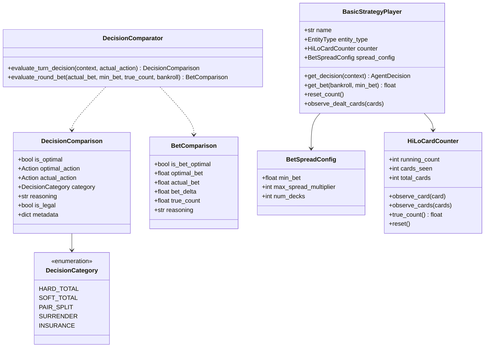

# Data Model: Basic Strategy Player & Decision Comparison Oracle

**Feature**: `specs/003-basic-strategy-player/`  
**Date**: 2026-10-11  

---

## 1. Domain Entities & Value Objects



---

## 2. Detailed Data Models

### `DecisionCategory` (Enum)
```python
class DecisionCategory(str, Enum):
    HARD_TOTAL = "hard_total"
    SOFT_TOTAL = "soft_total"
    PAIR_SPLIT = "pair_split"
    SURRENDER = "surrender"
    INSURANCE = "insurance"
```

### `DecisionComparison` (Dataclass)
```python
@dataclass(slots=True, frozen=True)
class DecisionComparison:
    is_optimal: bool
    optimal_action: Action
    actual_action: Action
    category: DecisionCategory
    reasoning: str
    is_legal: bool = True
    metadata: dict[str, Any] = field(default_factory=dict)
```

### `BetComparison` (Dataclass)
```python
@dataclass(slots=True, frozen=True)
class BetComparison:
    is_bet_optimal: bool
    optimal_bet: float
    actual_bet: float
    bet_delta: float
    true_count: float
    reasoning: str
```

### `BetSpreadConfig` (Dataclass)
```python
@dataclass(slots=True, frozen=True)
class BetSpreadConfig:
    min_bet: float = 50.0
    max_spread_multiplier: int = 12
    num_decks: int = 6
```

### `HiLoCardCounter` (Class)
Manages card counting state for Hi-Lo:
- Cards 2–6: $+1$
- Cards 7–9: $0$
- Cards 10, J, Q, K, A: $-1$
- Tracks cards seen, running count, and remaining decks estimation.

---

## 3. State Transitions & Lifecycle

### Player Round Lifecycle
1. **Between Rounds**:
   - If shoe reshuffled: `counter.reset()`.
   - Before Round: `get_bet(bankroll, min_bet)` calculates wager based on True Count.
2. **Dealing & Turn Progress**:
   - As visible cards are dealt, `counter.observe_card(card)` updates running count.
   - On player turn, `get_decision(context)` queries matrix lookup (Surrender $\rightarrow$ Pair $\rightarrow$ Soft $\rightarrow$ Hard).
3. **Turn Evaluation (Oracle)**:
   - Orchestrator or evaluator passes `context` and `actual_action` to `DecisionComparator.evaluate_turn_decision(...)`.
   - Yields `DecisionComparison` attached to event telemetry.
