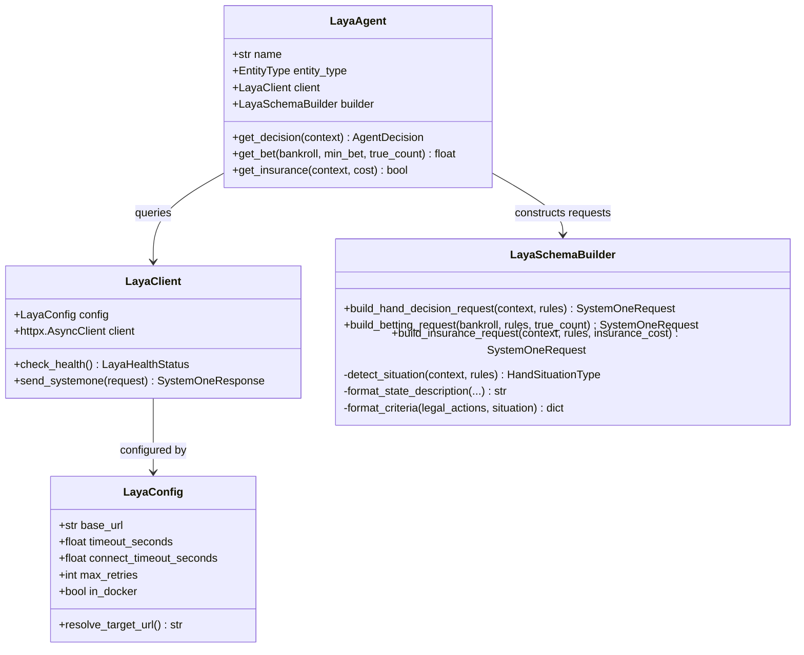

# Phase 1 Data Model: Laya Decision Agent Integration

**Feature**: `005-laya-agent-integration`
**Status**: Completed

## 1. Overview & Architecture

The Laya integration introduces domain and transfer models organized in `backend/app/integrations/laya/`:
1. **Configuration**: `LayaConfig`
2. **TypeSafe System One Transport**: `SystemOneRequest`, `SystemOneQuestion`, `ChoiceCriteria`, `SystemOneResponse`, `ChoiceAnswer`
3. **Situational Schema Models**: `HandSituationType`, `SituationalContext`, `SituationalSchema`
4. **Health & Diagnostics**: `LayaHealthStatus`, `LayaModelMetadata`
5. **Agent & Domain Telemetry Mapping**: `AgentDecision` mapping from `ChoiceAnswer`



---

## 2. Pydantic Domain & Transport Models

### 2.1 Configuration Model (`config.py`)

```python
class LayaConfig(BaseModel):
    """Runtime configuration for local Laya server connectivity."""
    base_url: str = Field(
        default="http://127.0.0.1:1234",
        description="Target Laya base URL specified in .env as LAYA_BASE_URL",
    )
    timeout_seconds: float = Field(
        default=3.0,
        ge=0.1,
        le=30.0,
        description="Maximum request timeout for inference calls",
    )
    connect_timeout_seconds: float = Field(
        default=1.5,
        ge=0.1,
        le=10.0,
        description="Maximum connection establishment timeout",
    )
    max_retries: int = Field(
        default=2,
        ge=0,
        le=5,
        description="Transient retry attempts before raising AgentFaultError",
    )

    def get_effective_url(self) -> str:
        """Translate localhost/127.0.0.1 to host.docker.internal if executing inside a Docker container."""
```

---

### 2.2 TypeSafe System One Schemas (`schemas.py`)

Models strictly conforming to TypeSafe System One payload definitions and [`docs/Laya_Example_Body.md`](file:///Users/andresdelgado/Documents/Coding/Decision_Blackjack/docs/Laya_Example_Body.md).

```python
class QuestionType(str, Enum):
    CHOICE = "choice"
    SCORE = "score"
    NOUL = "noul"


class ChoiceQuestion(BaseModel):
    """System One choice question requesting probability-weighted discrete selection."""
    type: Literal["choice"] = "choice"
    instructions: str = Field(
        ...,
        description="Action instructions guiding the model's judgment",
    )
    criteria: dict[str, str] = Field(
        ...,
        min_length=2,
        description="Dictionary mapping candidate label to concrete descriptive criteria",
    )


class SystemOneRequest(BaseModel):
    """Envelope payload dispatched to POST /v1/systemone."""
    state: str = Field(
        ...,
        description="Natural language summary of observable table and hand context",
    )
    questions: dict[str, ChoiceQuestion] = Field(
        ...,
        description="Dictionary of discrete questions keyed by question ID",
    )


class ChoiceAnswer(BaseModel):
    """Response answer for a Choice question."""
    choice: str = Field(..., description="Selected key from criteria")
    confidence: float = Field(..., ge=0.0, le=1.0, description="Confidence score")
    distribution: dict[str, float] = Field(
        default_factory=dict,
        description="Probability distribution across candidate criteria keys",
    )


class SystemOneResponse(BaseModel):
    """Response returned by Laya server."""
    answers: dict[str, ChoiceAnswer] = Field(
        default_factory=dict,
        description="Answers keyed by question ID",
    )
    meta: dict[str, Any] = Field(
        default_factory=dict,
        description="Model checkpoint revision, device, tokens, and inference duration",
    )
```

---

### 2.3 Situational Context & Schema Typing (`schemas.py` / `builder.py`)

Enumeration of the 5 distinct tactical game situations:

```python
class HandSituationType(str, Enum):
    INITIAL_PAIR_SPLIT = "initial_pair_split"
    INITIAL_STANDARD = "initial_standard"
    MULTI_CARD_DRAW = "multi_card_draw"
    INSURANCE_OFFER = "insurance_offer"
    ROUND_BETTING = "round_betting"
```

#### Situational Action Mapping Table

| Situation Type | Triggering Condition | Legal Actions Offered in `criteria` |
|----------------|----------------------|-------------------------------------|
| `INITIAL_PAIR_SPLIT` (Surrender Disabled) | 2 cards, identical rank, split limit not reached, bankroll $\ge$ bet, surrender disabled | `hit`, `stand`, `split`, and conditionally `double` |
| `INITIAL_PAIR_SPLIT` (Surrender Enabled) | 2 cards, identical rank, split limit not reached, bankroll $\ge$ bet, late surrender allowed | `hit`, `stand`, `split`, `surrender`, and conditionally `double` |
| `INITIAL_STANDARD` (Surrender Disabled) | 2 cards, non-pair, initial turn, surrender disabled | `hit`, `stand`, `double` |
| `INITIAL_STANDARD` (Surrender Enabled) | 2 cards, non-pair, initial turn, late surrender allowed | `hit`, `stand`, `double`, `surrender` |
| `MULTI_CARD_DRAW` | $\ge 3$ cards after hitting; double/split/surrender prohibited | Strictly `hit` and `stand` |
| `INSURANCE_OFFER` | Dealer upcard is Ace, pre-hand play | Strictly `accept` and `decline` |
| `ROUND_BETTING` | Pre-deal round initialization | Strictly discrete units: `1x`, `2x`, `4x`, `8x` (filtered by bankroll) |


---

### 2.4 Health Check Response Model (`schemas.py`)

```python
class LayaHealthStatus(BaseModel):
    """Health probe result from GET /health."""
    status: str = Field(..., description="'ok' when server is ready")
    loaded: list[str] = Field(default_factory=list, description="Loaded models list")
    revisions: dict[str, str] = Field(default_factory=dict, description="Model revision git commits")
    device: str = Field(default="cpu", description="Execution device: mps, cuda, or cpu")
```

---

## 3. Telemetry & Persistence Integration

When `LayaAgent.get_decision()` resolves:
- `AgentDecision.action`: Mapped from selected choice (`hit` $\to$ `Action.HIT`, `stand` $\to$ `Action.STAND`, `double` $\to$ `Action.DOUBLE`, `split` $\to$ `Action.SPLIT`, `surrender` $\to$ `Action.SURRENDER`).
- `AgentDecision.confidence`: Set to `ChoiceAnswer.confidence`.
- `AgentDecision.latency_ms`: High-resolution elapsed HTTP duration in milliseconds.
- `AgentDecision.metadata`:
  ```json
  {
    "provider": "laya",
    "endpoint": "/v1/systemone",
    "situation": "initial_pair_split",
    "distribution": {"hit": 0.05, "stand": 0.02, "split": 0.93},
    "device": "mps",
    "model_revision": "7b928d828b7b0e022f929d9bd2e44165aa270148",
    "raw_request": {...},
    "raw_response": {...}
  }
  ```
- This metadata flows seamlessly into `decisions` and `model_responses` database tables via `SimulationPersistenceListener` (completed in Spec 004).
