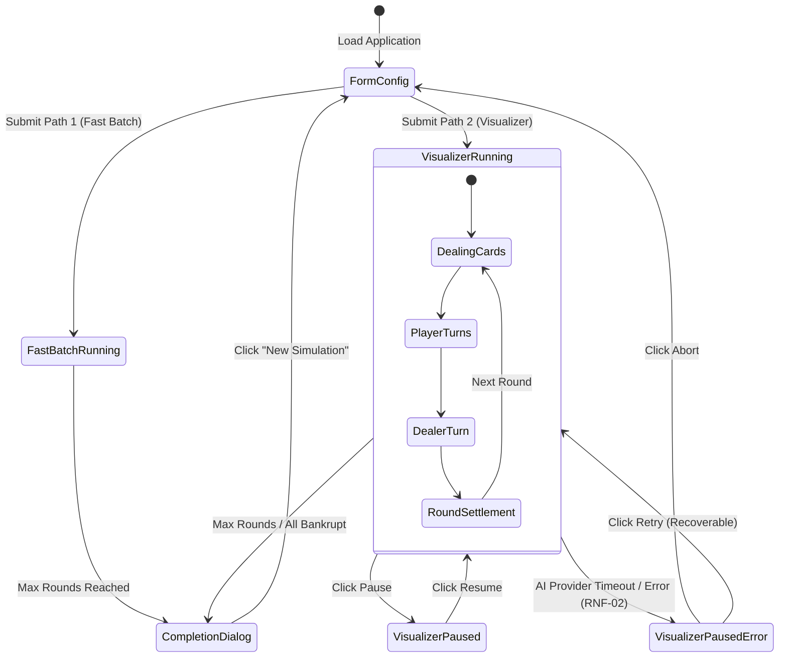

# Data Model: Decision Blackjack Frontend Web Application

**Feature**: `008-frontend-web-application`  
**Date**: 2026-10-13  
**Status**: Draft  

---

## 1. Domain Entities & State Types

### 1.1 `VariantRulesFormValues`
Configuration payload captured by `SimulationConfigForm` and dispatched to `POST /api/simulations`:

```typescript
export interface VariantRulesFormValues {
  // Dealer & Table Rules
  soft_17_rule: 'S17' | 'H17';
  blackjack_payout: 1.5 | 1.2 | 1.0;
  hole_card_rule: 'AMERICAN_PEEK' | 'EUROPEAN_NO_HOLE_CARD';
  insurance_allowed: boolean;
  surrender_rule: 'LATE' | 'EARLY' | 'NO_SURRENDER';

  // Player Splits & Double Rules
  double_after_split: boolean;
  max_split_hands: number; // 1 to 4
  resplit_aces: boolean;
  hit_split_aces: boolean;

  // Shoe & Deck Setup
  num_decks: 1 | 2 | 4 | 6 | 8;
  penetration: number; // 0.50 to 0.85
  burn_cards_count: number; // 0 to 5

  // Economics & Limits
  initial_bankroll: number; // >= 10.0
  min_bet: number; // >= 1.0
  max_bet: number; // >= min_bet
  stop_on_all_bankrupt: boolean;

  // Simulation Scope & Operational Controls
  max_rounds: number; // 1 to 100,000
  num_simulations: number; // 1 to 1,000
  seed: number | null; // optional integer
  execution_mode: 'visualized' | 'fast_batch';
  delay_ms: number; // 0 to 2,000
  mock_mode: boolean;

  // Player Selection (FR-001)
  selected_players: {
    jev: boolean;
    laya: boolean;
    optimal: boolean;
  };
}
```

**Validation Rules**:
- `min_bet <= max_bet`
- `initial_bankroll >= min_bet`
- `penetration >= 0.50 && penetration <= 0.85`
- `max_split_hands >= 1 && max_split_hands <= 4`
- `max_rounds >= 1 && max_rounds <= 100000`
- `atLeastOnePlayerSelected`: At least one of `selected_players.jev`, `selected_players.laya`, `selected_players.optimal` must be `true`.

---

### 1.2 `CardVisualState`
Visual representation of a single card on the table:

```typescript
export interface CardVisualState {
  id: string; // unique card render id (e.g., "card-jev-0-1")
  card_str: string; // "10♠", "A♥", "K♦", "7♣"
  rank: string; // "10", "A", "K", "7"
  suit: 'spades' | 'hearts' | 'diamonds' | 'clubs';
  svg_path: string; // "/Assets/cards/10_of_spades.svg"
  is_hidden: boolean; // true for dealer face-down hole card
  is_horizontal: boolean; // true if dealt on a double down (rotated 90deg)
  is_split: boolean;
}
```

---

### 1.3 `PlayerTableState`
Complete visual and statistical state for one column of the 2x3 grid:

```typescript
export type EntityId = 'jev' | 'laya' | 'optimal';

export interface PlayerTableState {
  entity_id: EntityId;
  name: string; // "Jev (System One)", "Laya (Local)", "Basic Strategy"
  carpet_color: string; // "rgb(213, 120, 190)", "rgb(68, 120, 208)", "rgb(118, 194, 154)"
  is_selected: boolean; // false -> empty table, darkened stats
  is_bankrupt: boolean;

  // Table Cards (Top Row)
  dealer_cards: CardVisualState[];
  dealer_total: number;
  dealer_is_busted: boolean;
  player_hands: {
    hand_id: string;
    cards: CardVisualState[];
    total: number;
    is_soft: boolean;
    is_busted: boolean;
    is_blackjack: boolean;
    is_doubled: boolean;
    is_surrendered: boolean;
  }[];
  active_hand_index: number;

  // Live Stats (Bottom Row)
  current_bet: number;
  last_action: string | null; // "HIT", "STAND", "DOUBLE", "SPLIT", "SURRENDER"
  last_comparison: {
    is_optimal: boolean;
    optimal_action: string;
    category: string;
    reasoning: string;
  } | null;

  // Financial State
  current_bankroll: number;
  starting_bankroll: number;
  net_profit_delta: number; // e.g. +50.0

  // 3 Dynamic Graph Bars Data
  optimality_rate: number; // 0.0 to 1.0 (Basic Strategy agreement %)
  win_loss_push: {
    wins: number;
    losses: number;
    pushes: number;
    total: number;
  };
  relative_bankroll_pct: number; // (current / initial) * 100
}
```

---

### 1.4 `SimulationSessionState`
Top-level application state managed by `SimulationContext`:

```typescript
export type SimulationLifecycle =
  | 'INITIALIZING'
  | 'RUNNING'
  | 'PAUSED'
  | 'PAUSED_ERROR'
  | 'COMPLETED';

export interface SimulationSessionState {
  session_id: string | null;
  run_id: string | null;
  status: SimulationLifecycle;
  execution_mode: 'visualized' | 'fast_batch';
  current_round: number;
  max_rounds: number;
  shoe_generation: number;
  delay_ms: number;
  rules: VariantRulesFormValues | null;

  // 3 Player Columns
  tables: Record<EntityId, PlayerTableState>;

  // RNF-02 Fault Notification
  active_fault: {
    entity_id: string;
    error_message: string;
    is_recoverable: boolean;
  } | null;

  // Completion Summary
  completion_summary: {
    total_rounds: number;
    players: Record<
      EntityId,
      {
        final_bankroll: number;
        net_profit: number;
        win_rate: number;
        optimality_rate: number;
      }
    >;
  } | null;
}
```

---

## 2. State Machine Transitions


