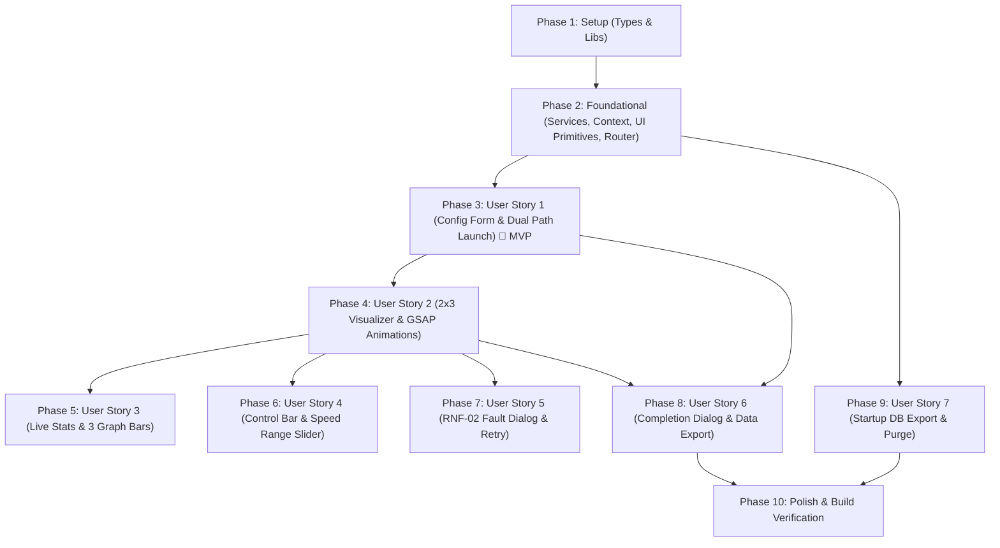

# Implementation Tasks: Decision Blackjack Frontend Web Application

**Feature**: `008-frontend-web-application`  
**Branch**: `008-frontend-web-application`  
**Spec**: [`specs/008-frontend-web-application/spec.md`](./spec.md)  
**Plan**: [`specs/008-frontend-web-application/plan.md`](./plan.md)  

---

## Phase 1: Setup (Shared Infrastructure)

**Purpose**: Core types, utility helpers, and asset resolvers shared across all frontend features.

- [X] T001 Define core domain interfaces and validation types in `frontend/src/types/simulation.ts` (`VariantRulesFormValues` with `min_bet <= max_bet`, `initial_bankroll >= min_bet`, `penetration >= 0.50 && <= 0.85`, `max_split_hands >= 1 && <= 4`, `max_rounds >= 1 && <= 100000`, `CardVisualState`, `PlayerTableState`, `SimulationSessionState`)
- [X] T002 [P] Define API transport and WebSocket messaging schemas in `frontend/src/types/api.ts` (`SimulationResponse`, `InboundTelemetryEvent`, `OutboundCommand`, `PurgeDatabaseResponse`)
- [X] T003 [P] Implement `cn()` classname utility function using `clsx` and `tailwind-merge` in `frontend/src/lib/utils.ts`
- [X] T004 [P] Implement SVG playing card asset resolver in `frontend/src/lib/cardAssets.ts` mapping nominal card strings (e.g., `"10♠"`, `"A♥"`) to `frontend/Assets/cards/*.svg` and `card_back.svg`

---

## Phase 2: Foundational (Blocking Prerequisites)

**Purpose**: Networking layer, global telemetry state context, and UI component primitives.

**⚠️ CRITICAL**: No user story work can begin until this foundational phase is complete.

- [X] T005 Implement REST API client in `frontend/src/services/apiClient.ts` handling `POST /api/simulations`, `POST /api/simulations/{id}/control`, `GET /api/export/simulations/{id}`, `GET /api/export/database`, and `DELETE /api/database`
- [X] T006 Implement native WebSocket client manager in `frontend/src/services/websocketService.ts` connecting to `ws://localhost:8000/ws/simulations/{session_id}` with event subscription and outbound command dispatching
- [X] T007 Implement centralized telemetry and simulation lifecycle store in `frontend/src/context/SimulationContext.tsx` handling `INITIALIZING`, `RUNNING`, `PAUSED`, `PAUSED_ERROR`, and `COMPLETED`
- [X] T008 [P] Implement shadcn Button and Badge UI components in `frontend/src/components/ui/button.tsx` and `frontend/src/components/ui/badge.tsx`
- [X] T009 [P] Implement shadcn Card, Input, Label, and Select UI components in `frontend/src/components/ui/card.tsx`, `frontend/src/components/ui/input.tsx`, `frontend/src/components/ui/label.tsx`, and `frontend/src/components/ui/select.tsx`
- [X] T010 [P] Implement shadcn Slider, Switch, Progress, and Dialog UI components in `frontend/src/components/ui/slider.tsx`, `frontend/src/components/ui/switch.tsx`, `frontend/src/components/ui/progress.tsx`, and `frontend/src/components/ui/dialog.tsx`
- [X] T011 Configure React Router 8 SPA root in `frontend/src/App.tsx` and `frontend/src/main.tsx` mounting `BrowserRouter` and routes for `/`, `/batch/:sessionId`, `/simulate/:sessionId`, and `/complete/:sessionId`

**Checkpoint**: Foundation ready — user story implementations can now begin.

---

## Phase 3: User Story 1 - Interactive Rule Configuration & Dual-Path Launch (Priority: P1) 🎯 MVP

**Goal**: Present an interactive form to configure all blackjack variant rules, select players, toggle mock mode, and launch either Fast Batch (Path 1) or Real-Time Visualizer (Path 2).

**Independent Test**: Load `/`, fill variant rules, verify inline validation on invalid bounds (`min_bet > max_bet`), launch Fast Batch, and verify the progress card renders with round count and Cancel button.

- [X] T012 [P] [US1] Build interactive variant rules form with React Hook Form in `frontend/src/forms/SimulationConfigForm.tsx` presenting Soft 17 (`S17`/`H17`), BJ payout (`3:2`, `6:5`, `1:1`), Peek vs ENHC, Insurance, Surrender (`Late`, `Early`, `None`), DAS, Splits (1–4), RSA, Hit Split Aces, Decks (1–8), Penetration (50%–85%), Burn cards (0–5), Bankroll, Min/Max bets, Rounds (1–100,000), Seed, Mock Mode toggle, and individual player toggles (Jev, Laya, Basic Strategy) requiring `atLeastOnePlayerSelected`
- [X] T013 [P] [US1] Build fast batch execution card with real-time round indicator and Cancel button in `frontend/src/visualization/FastBatchProgressCard.tsx`
- [X] T014 [US1] Build fast batch route page in `frontend/src/pages/FastBatchPage.tsx` listening to session updates and redirecting to `/complete/:sessionId` upon completion
- [X] T015 [US1] Build configuration route page in `frontend/src/pages/ConfigurationPage.tsx` embedding `SimulationConfigForm` and dispatching simulation creation to `POST /api/simulations`

**Checkpoint**: User Story 1 functional — users can configure rules and run Fast Batch simulations to completion.

---

## Phase 4: User Story 2 - Real-Time Tri-Entity Table Visualizer (2x3 Grid & GSAP) (Priority: P1)

**Goal**: Render the synchronized 2x3 grid with exact table carpet colors (Jev: `rgb(213, 120, 190)`, Laya: `rgb(68, 120, 208)`, Basic Strategy: `rgb(118, 194, 154)`), GSAP card animations, and 90-degree horizontal rotation for doubled cards.

**Independent Test**: Launch Path 2 with all players active; observe 3 columns with dealer and player cards dealing via GSAP, horizontal orientation on double down, and empty table rendering for deselected players.

- [X] T016 [P] [US2] Implement single playing card component with GSAP dealing and horizontal 90-degree double down transform in `frontend/src/components/CardView.tsx`
- [X] T017 [P] [US2] Implement table carpet row component in `frontend/src/visualization/TableCarpetRow.tsx` rendering exact background carpet colors (Jev: `rgb(213, 120, 190)`, Laya: `rgb(68, 120, 208)`, Basic Strategy: `rgb(118, 194, 154)`), split hand slots, dealer cards with face-down hole card, and empty table display when `is_selected === false`
- [X] T018 [US2] Implement 2x3 grid visualizer container in `frontend/src/visualization/VisualizerGrid2x3.tsx` arranging the 3 player columns (Jev, Laya, Basic Strategy)
- [X] T019 [US2] Implement real-time visualizer page in `frontend/src/pages/VisualizerPage.tsx` connecting WebSocket, streaming round events, and rendering `VisualizerGrid2x3`

**Checkpoint**: User Stories 1 AND 2 functional — visualizer animates live card gameplay across the 2x3 grid.

---

## Phase 5: User Story 3 - Live Player Stats & 3 Dynamic Graph Bars (Priority: P2)

**Goal**: Render the bottom row of each player column showing current bet, AI action decision badge, basic strategy comparison, bankroll state (`+$50`), and 3 dynamic graph bars (Optimality %, Win/Loss/Push %, Relative Bankroll %).

**Independent Test**: During live play, verify the bottom row updates with each decision and settlement, showing correct bet, action badge, and animated graph bars; verify deselected players show darkened/disabled stats (`opacity-40 grayscale`).

- [X] T020 [US3] Implement live stats row component in `frontend/src/visualization/LiveStatsRow.tsx` displaying `Current Bet: $X`, `Action: [BADGE]`, basic strategy comparison banner (`✓ Matches Optimal` or `✗ Deviates: Recommended [Action]`), bankroll delta (`+$50` / `-$20`), and darkened/disabled state when `is_selected === false`
- [X] T021 [US3] Implement the 3 dynamic graph bars in `frontend/src/visualization/LiveStatsRow.tsx`: (1) Basic Strategy Optimality Rate (% agreement), (2) Win / Loss / Push distribution percentage, and (3) Current bankroll relative to starting bankroll
- [X] T022 [US3] Wire `LiveStatsRow` into `frontend/src/visualization/VisualizerGrid2x3.tsx` under each player's table carpet row

**Checkpoint**: User Stories 1, 2, and 3 functional — live comparative stats and graph bars update in real time.

---

## Phase 6: User Story 4 - Live Interactive Flow Controls & Speed Adjustment (Priority: P2)

**Goal**: Provide a bottom control bar with Pause/Resume, dynamic speed range slider (0–2000 ms) with proportional GSAP duration scaling, Cancel/Stop, and Export Database.

**Independent Test**: Drag speed slider to 0 ms and verify card animations place instantly without delay; click Pause and verify all tables halt; click Resume to continue; click Cancel to abort.

- [X] T023 [P] [US4] Implement bottom control bar component in `frontend/src/components/ControlBar.tsx` with Pause/Resume toggle, range slider for speed delay (0 ms to 2,000 ms), Cancel button, and Export Database button
- [X] T024 [US4] Implement dynamic animation duration scaling in `frontend/src/components/CardView.tsx` calculating `duration = Math.max(0, Math.min(0.4, (delay_ms / 1000) * 0.4))` transitioning to instant placement (0 s) at `delay_ms === 0`
- [X] T025 [US4] Integrate `ControlBar` at the bottom of `frontend/src/pages/VisualizerPage.tsx` dispatching `pause`, `resume`, `set_speed`, and `stop` WebSocket commands

**Checkpoint**: User Story 4 functional — full interactive simulation flow control and speed adjustments operational.

---

## Phase 7: User Story 5 - Fault Notification & Quick-Action Recovery (RNF-02) (Priority: P2)

**Goal**: Pause the visualizer on AI provider timeouts/errors and display an alert dialog with a simple explanation and a "Retry Turn" button for recoverable errors.

**Independent Test**: Trigger an AI timeout; verify visualizer pauses immediately in `PAUSED_ERROR`, displays alert "Timeout error for Jev", and clicking "Retry Turn" dispatches `{ command: "retry", entity_id: "jev" }` to resume play.

- [X] T026 [US5] Implement fault alert dialog component in `frontend/src/components/FaultAlertModal.tsx` displaying simple error explanation (e.g. `"Timeout error for Jev"`), "Retry Turn" button when recoverable, and "Abort" button
- [X] T027 [US5] Wire fault detection into `frontend/src/context/SimulationContext.tsx` handling `SESSION_ERROR` event frames and dispatching retry command via WebSocket

**Checkpoint**: User Story 5 functional — RNF-02 fault resilience and interactive retry operational.

---

## Phase 8: User Story 6 - Simulation Completion Dialog & Data Export (Priority: P3)

**Goal**: Automatically navigate to a completion page displaying a success dialog with a Tri-Player summary table, "Export Simulation Data" button, and "New Simulation" button.

**Independent Test**: Complete a simulation in Fast Batch or Visualizer mode; verify navigation to `/complete/:sessionId`, verify summary metrics (Final Bankroll, Net P/L, Win Rate %, Agreement %) for all three players, test JSON export download, and test "New Simulation" redirect to `/`.

- [X] T028 [P] [US6] Implement Tri-Player summary table component in `frontend/src/components/TriPlayerSummaryTable.tsx` displaying Final Bankroll, Net P/L ($), Win Rate %, and Basic Strategy Agreement % for Jev, Laya, and Basic Strategy
- [X] T029 [US6] Implement completion route page in `frontend/src/pages/CompletionPage.tsx` rendering success dialog with `TriPlayerSummaryTable`, "Export Simulation Data" button triggering `/api/export/simulations/{id}`, and "New Simulation" button navigating to `/`
- [X] T030 [US6] Add automatic redirect to `/complete/:sessionId` in `frontend/src/pages/VisualizerPage.tsx` and `frontend/src/pages/FastBatchPage.tsx` upon receiving `SESSION_COMPLETED`

**Checkpoint**: User Story 6 functional — clean simulation completion flow with metrics summary and data export.

---

## Phase 9: User Story 7 - Database Maintenance & Archival at Startup (Priority: P3)

**Goal**: Provide global actions on the startup screen to download the full database archive or purge all records with a confirmation dialog.

**Independent Test**: On `/`, click "Export Whole Database" and verify `/api/export/database` downloads; click "Delete Database", confirm dialog, and verify all 15 tables are truncated via `DELETE /api/database`.

- [X] T031 [P] [US7] Implement application navbar in `frontend/src/components/Navbar.tsx` displaying brand header and global action buttons for "Export Whole Database" and "Delete Database"
- [X] T032 [US7] Implement database purge confirmation dialog in `frontend/src/components/DeleteDatabaseModal.tsx` requiring explicit confirmation before executing `DELETE /api/database`
- [X] T033 [US7] Integrate `Navbar` and `DeleteDatabaseModal` into `frontend/src/pages/ConfigurationPage.tsx`

**Checkpoint**: User Story 7 functional — database archival and reset controls accessible at application startup.

---

## Phase 10: Polish & Cross-Cutting Verification

**Purpose**: End-to-end integration validation, TypeScript compilation, and documentation updates.

- [X] T034 Verify strict TypeScript compilation with zero errors via `npx tsc --noEmit` in `frontend/`
- [X] T035 Execute production build via `npm run build` in `frontend/` verifying zero bundling or styling errors
- [X] T036 Run end-to-end manual verification against running backend covering all 7 scenarios in `specs/008-frontend-web-application/quickstart.md`
- [X] T037 [P] Update documentation in `docs/session_logs.md` recording Feature 008 completion, architecture, and verification summary

---

## Dependencies & Execution Order

### Phase Dependencies

### Parallel Opportunities

- **Phase 1 Setup**: T002, T003, T004 can execute concurrently.
- **Phase 2 Foundational**: T008, T009, T010 can execute concurrently once T001 is complete.
- **Phase 3 US1**: T012 and T013 can execute in parallel.
- **Phase 4 US2**: T016 and T017 can execute in parallel.
- **Phase 8 US6 & Phase 9 US7**: T028 and T031 can execute in parallel.

---

## Implementation Strategy

### MVP First (User Story 1 & Fast Batch)
1. Complete Phase 1 (Setup: Types, utils, card assets)
2. Complete Phase 2 (Foundational: API client, WebSocket manager, Context, UI primitives, Router)
3. Complete Phase 3 (User Story 1: Configuration Form + Fast Batch Page)
4. **Validate MVP**: Launch form in Fast Batch mode, verify round execution and cancel without errors.

### Incremental Feature Expansion
1. Add Phase 4 (User Story 2: 2x3 Grid with carpet colors and GSAP card animations).
2. Add Phase 5 (User Story 3: Live Stats with Current Bet, Decision badge, and 3 Dynamic Graph Bars).
3. Add Phase 6 (User Story 4: Control Bar with dynamic speed slider scaling down to 0 ms).
4. Add Phase 7 (User Story 5: RNF-02 Fault Modal with Retry).
5. Add Phase 8 (User Story 6: Completion Page with Tri-Player summary table and data export).
6. Add Phase 9 (User Story 7: Startup DB tools on Navbar).
7. Execute Phase 10 (Build verification, quickstart validation, and session logs).
